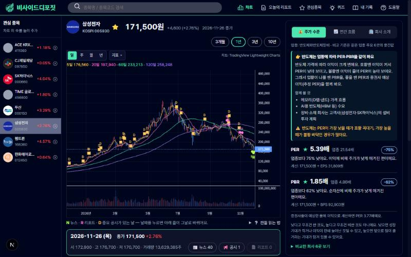
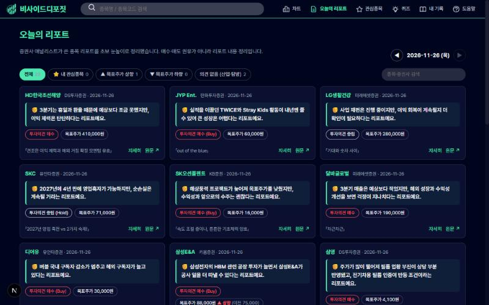
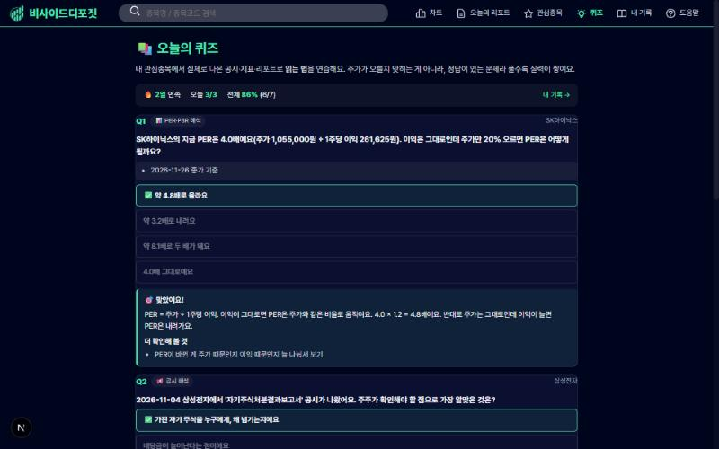

# 비사이드디포짓 (BESIDES DEPOSITS)

> 주식 초보가 **차트 · 뉴스 · 증권사 리포트 · 공시**를 한 화면에서 쉽게 훑어보고, 매일 퀴즈로 **읽는 법**을 익히는 개인용 웹서비스입니다.



| 오늘의 리포트 | 오늘의 읽기 퀴즈 |
|---|---|
|  |  |

## 왜 만들었나

주식을 처음 공부하면 정보는 넘치는데 **무엇을 어떻게 읽어야 할지** 모릅니다. 차트는 차트 앱에서, 뉴스는 포털에서, 리포트는 증권사 사이트에서 따로 봐야 하고, 리포트와 공시는 용어부터 어렵습니다.

비사이드디포짓은 이 흩어진 정보를 **한 화면에 날짜별로 모으고, 초보의 말로 풀어 주는 것**에서 출발했습니다. 직접 매일 쓰는 사람이 만든 서비스라, 써 보며 도움이 되지 않은 기능은 과감히 걷어내고 쓸수록 배움이 쌓이는 기능으로 다듬고 있습니다.

## 주요 기능

- **차트 위 뉴스·리포트·공시** — 캔들 차트의 날짜를 누르면 그날의 뉴스, 증권사 리포트, 공시가 함께 뜹니다.
- **오늘의 리포트** — 매일 나오는 증권사 종목 리포트를 모아 "쉽게 말하면" 한 줄 요약, 투자의견, 목표주가 변화와 함께 보여 줍니다.
- **PER·PBR 업종 가이드** — 숫자만 보여 주지 않고, 업종마다 어떤 지표를 봐야 하는지와 업종 평균 대비 위치를 설명합니다.
- **공시 풀이** — OpenDART 공시를 좋은 소식/나쁜 소식으로 나누고, 무슨 뜻인지 풀어 줍니다.
- **오늘의 읽기 퀴즈** — 내 관심종목에서 실제로 나온 공시·지표·리포트로 정답이 있는 문제를 매일 3개 풉니다. 주가 방향을 맞히는 게임이 아니라, 읽는 실력을 쌓는 연습입니다.
- **관심종목 · 내 기록** — 관심종목 목록과 퀴즈 연속 학습일, 정답률을 기록합니다.

## 어떻게 만들었나

- **AI 바이브코딩** — 기획, 구현, 리뷰까지 AI 코딩 도구(Claude Code)와 함께 혼자 만들고 있습니다.
- **백엔드는 내가 이해할 수 있게** — 본업이 Java/Spring 백엔드 개발이라, FastAPI를 쓰되 폴더와 계층을 Spring처럼(router = Controller, service, repository, models = Entity, schemas = DTO) 나눴습니다. 대응표: [docs/spring-to-fastapi.md](docs/spring-to-fastapi.md)
- **추가 비용 없이** — 무료 데이터 출처만 쓰고, 서버는 개인 PC에서 돌립니다. 매일 데이터 수집은 작업 스케줄러로, 리포트 쉬운 말 요약은 AI 예약 작업으로 자동 실행합니다.
- **결정은 기록으로** — 기능을 넣고 뺀 이유를 [docs/decisions.md](docs/decisions.md)에 날짜별로 남깁니다.

## 기술 스택

| 영역 | 사용 기술 |
|---|---|
| 백엔드 | Python 3.12, FastAPI, SQLAlchemy, SQLite |
| 프론트엔드 | Next.js, TypeScript, TradingView Lightweight Charts |
| 데이터 | FinanceDataReader(주가), KRX(ETF 구성 비중), OpenDART(공시), 네이버 증권(뉴스·리포트·기업 지표) |
| 개발 방식 | AI 바이브코딩(Claude Code) |

## 실행 방법

필요한 것: Python 3.12, Node.js 22

```bash
# 백엔드 → http://localhost:8100/docs
cd backend
py -3.12 -m venv .venv
.venv\Scripts\pip install -r requirements.txt
.venv\Scripts\uvicorn app.main:app --reload --port 8100

# 프론트엔드 → http://localhost:3000
cd frontend
npm install
npm run dev
```

Windows에서는 저장소 폴더의 `dev.cmd`로 두 서버를 한 번에 띄울 수 있습니다. API 키 등 비밀값은 `.env`에만 두며 저장소에 올리지 않습니다.

## 문서

- [작업 문서 (설계·진행 상황·운영 메모)](docs/PROJECT.md)
- [결정 기록](docs/decisions.md)
- [Spring ↔ FastAPI 대응표](docs/spring-to-fastapi.md)
- [쉬운 말 요약 지침](docs/easy-summary-guide.md)

## 알려 드립니다

- 이 서비스의 요약과 풀이는 공개된 정보를 쉽게 읽도록 정리한 것이며, **특정 종목의 매수·매도를 권유하지 않습니다.** 투자 판단과 책임은 본인에게 있습니다.
- 증권사 리포트 원문은 저장소에 올리지 않으며, 요약과 원문 링크만 보여 줍니다.
